## About

I'm a software engineering student at ITLA and a full-stack developer in the Dominican Republic. I build complete applications, from APIs and data models to cloud deployment. My work spans clean architecture, application security, AI-assisted analysis, and product-focused web apps.

**Most used:** C# and TypeScript. **Currently learning:** Go and Flutter.

## What I'm building

* **[Armelis](https://github.com/Johanvasquezdev/Armelis):** Open-source application security intelligence for AI-assisted teams. It maps vulnerabilities into attack paths and helps teams prioritize fixes.
* **[Meridas](https://github.com/Johanvasquezdev/Meridas-Assistant):** A proprietary operational evidence intelligence system. It checks answers against source documents, detects conflicting versions, and routes unresolved questions for human review.
* **[MedAgenda](https://github.com/Johanvasquezdev/MedAgenda):** A healthcare scheduling system for patients, doctors, and administrators, with a .NET API and web and desktop clients.
* **[Artemis Banking](https://github.com/Johanvasquezdev/ArtemisBankingPro):** A .NET 9 banking application built with Onion Architecture, CQRS, and Azure Functions.
* **AegisSpace:** A multi-cloud change observatory concept for tracking infrastructure events, detecting Terraform drift, and comparing AI agents.
* **Ossandra:** An operational intelligence platform connecting CRM, POS, and inventory with observability, security, analytics, and AI.
* **PyroGravity (Flame in Freefall):** A NASA Space Apps Challenge 2026 team prototype for exploring and comparing microgravity combustion experiments. I'm building its evidence-backed AI analysis component.

## Tech stack

### Languages

  
  
  
  
  
  
  
  

### Frontend and mobile

  
  
  
  
  

### Backend and architecture

  
  
  
  
  
  
  
  

### Data, cloud, and delivery

  
  
  
  
  
  
  
  

### AI, security, and tools

  
  
  
  
  
  
  
  
  

## GitHub stats

  
  

## Let's connect

  
  

